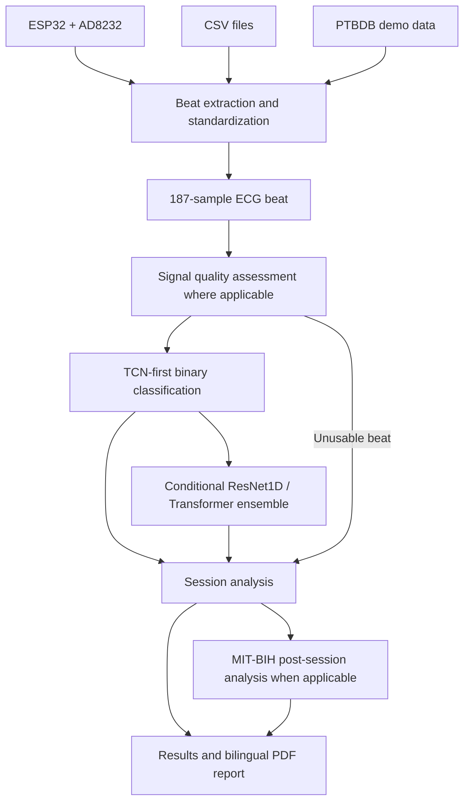

# PulseAI — Smart ECG Monitoring and Classification System Using AI

**Python 3.12 · TensorFlow / Keras · PySide6 · ESP32 · AD8232**

PulseAI is an AI-assisted ECG monitoring and classification desktop application developed as a Computer Information Systems graduation project at Al al-Bayt University (2025–2026). It integrates ECG acquisition, signal processing, deep learning, real-time visualization, post-session analysis, and bilingual PDF reporting in a single workflow.

The system is an academic prototype designed to run locally. No cloud deployment is required.

## Key Features

- **Multiple ECG input sources:** live ESP32/AD8232 acquisition over USB serial, CSV beat files, and PTBDB demo playback.
- **Real-time monitoring:** waveform visualization, beat classification, abnormality probability, and heart rate (BPM) when available.
- **Signal quality assessment:** baseline and noise handling, motion artifact detection, lead-off feedback, and rejection of unreliable beats.
- **AI-based binary classification:** a TCN-first conditional ensemble with ResNet1D and Transformer models for uncertain predictions.
- **Post-session arrhythmia analysis:** a separate two-stage MIT-BIH pipeline with confidence-based rejection.
- **Session analytics:** normal, abnormal, and noisy beat distribution, BPM statistics, HRV (SDNN) when timing data is available, and tachycardia-related indicators.
- **Bilingual reporting:** English and Arabic session summaries, findings, and PDF export.

## System Architecture



The hardware prototype uses an AD8232 ECG sensor, an ESP32 microcontroller, three electrodes, and a custom 3D-printed enclosure. ECG data is transmitted to the desktop application through USB serial communication. Hardware is optional for CSV-based testing.

## AI Models

### Live beat classification — PTBDB

Each beat is standardized to 187 samples. The live pipeline first evaluates the beat using a Temporal Convolutional Network (TCN). Confident predictions are used directly; uncertain predictions activate a weighted ensemble of TCN, ResNet1D, and Transformer outputs. Additional signal-quality and motion checks are applied to hardware input.

### Post-session analysis — MIT-BIH

| Stage | Classification task |
| --- | --- |
| Stage 1 | Normal-like vs. abnormal, with an unknown/low-confidence option |
| Stage 2 | S: supraventricular ectopic beats; V: ventricular ectopic beats; F: fusion beats |

Low-confidence subtype predictions are reported as unknown rather than forcing a class assignment.

## Model Evaluation

Results reported in Chapter 12 of the graduation project documentation:

| Dataset / model | Test samples | Accuracy | F1-score |
| --- | ---: | ---: | ---: |
| PTBDB — Final live pipeline | 2,911 | 98.90% | 99.24% |
| MIT-BIH — Stage 1 binary model | 21,892 | 98.90% | 96.77% |
| MIT-BIH — Stage 2 subtype model | 2,166 | 94.64% | 90.47% (macro) |

The PTBDB final pipeline achieved a ROC-AUC of 99.82%. MIT-BIH Stage 1 achieved a ROC-AUC of 99.60%. For MIT-BIH Stage 2, confidence rejection resulted in 72.85% coverage and a 27.15% unknown rate; accuracy among covered predictions was 99.24%.

These are documented dataset evaluation results, not clinical validation results or measured diagnostic accuracy on live patients.

## Technology Stack

| Component | Technologies |
| --- | --- |
| Desktop interface | Python, PySide6, PyQtGraph |
| Deep learning | TensorFlow, Keras, TCN, ResNet1D, Transformer |
| Data processing and evaluation | NumPy, Pandas, SciPy, Scikit-learn |
| Hardware and communication | ESP32, AD8232, PySerial |
| Reporting and visualization | ReportLab, Matplotlib, Arabic text support |
| Experimental image processing | OpenCV |

## Getting Started

The application has been launched successfully on Windows with Python 3.12.10 in the development environment. A clean-install test is recommended when setting up a new machine.

### 1. Clone the repository

```powershell
git clone https://github.com/hebasamer943/ECG.git
cd ECG
```

### 2. Create and activate a virtual environment

```powershell
python -m venv .venv
.\.venv\Scripts\Activate.ps1
```

### 3. Install dependencies

```powershell
python -m pip install -r requirements.txt
```

### 4. Start the desktop application

```powershell
python main.py
```

Keep the trained model files and their metadata in their original `Models/` directory.

### 5. Choose an input source

- **CSV:** select a compatible CSV file containing one ECG beat per row, with 187 numerical signal values. An optional 188th column may contain the binary label (0 = normal, 1 = abnormal).
- **Demo:** requires the PTBDB CSV dataset files, `ptbdb_normal.csv` and `ptbdb_abnormal.csv`, in the location expected by the application.
- **Hardware:** requires the compatible ESP32 firmware and AD8232 prototype; select the corresponding serial COM port. See the project documentation for the hardware design and serial protocol. This prototype is not certified for clinical or patient use.

The raw datasets and training caches are excluded from the repository. Download the appropriate datasets separately if required for demo playback or training. Consult the source dataset terms before redistribution.

## Repository Structure

```text
ECG/
├── AI/                         # Model training and experiments
├── Models/                     # Trained models and model metadata
├── desktop_app/                # Desktop application source code
├── Reports/                    # Evaluation outputs and figures
├── docs/                       # Project documentation
├── AI_MODEL_DOCUMENTATION.md    # Additional model documentation
├── AI_ROADMAP.md                # AI development roadmap
├── main.py                     # Application entry point
├── requirements.txt            # Python dependencies
├── .gitignore
└── README.md
```

Additional evaluation and training utilities are located in the repository root.

## Project Documentation & Interface Screenshots

[Read the full PulseAI project documentation (PDF)](docs/ECG_Project_Documentation.pdf)

The documentation includes the system architecture, hardware design, software implementation, model evaluation, confusion matrices, training curves, application screenshots, and report examples.

| Section | PDF pages |
| --- | --- |
| System architecture | 13–16 |
| Hardware prototype | 17–21 |
| Live classification and MIT-BIH analysis | 26–33 |
| Desktop interface screenshots | 35–37 |
| Testing and model evaluation | 48–56 |
| Application results and sample PDF report | 57–60 |

## Limitations and Future Work

- Live hardware signal quality is affected by movement, electrode contact, and hardware stability.
- Live classification is binary; the separate MIT-BIH module covers selected abnormal beat subtypes only.
- ECG image input was explored experimentally and is not part of the final evaluated core workflow.
- Further work includes hardware filtering, broader ECG recordings, improved subtype classification, image analysis, and clinical validation. External LLM-based reporting is a potential future enhancement, not a core feature.

## Academic Context

Bachelor's graduation project in Computer Information Systems, Prince Al Hussein bin Abdullah College of Information Technology, Al al-Bayt University, second semester 2025–2026.

## Medical Disclaimer

PulseAI is an academic prototype for educational and research purposes. It is not a certified medical device, has not been clinically validated, and must not be used for medical diagnosis, treatment decisions, or as a substitute for professional medical care.
